<picture><source media="(prefers-color-scheme: dark)" srcset="assets/hero-dark.svg"><source media="(prefers-color-scheme: light)" srcset="assets/hero-light.svg"></picture>

<a href="https://chinmay-sawant-product-engineer.vercel.app"><picture><source media="(prefers-color-scheme: dark)" srcset="assets/btn-portfolio-dark.svg"><source media="(prefers-color-scheme: light)" srcset="assets/btn-portfolio-light.svg"></picture></a>
<a href="https://www.linkedin.com/in/chinmay-sawant-9b79a5192"><picture><source media="(prefers-color-scheme: dark)" srcset="assets/btn-linkedin-dark.svg"><source media="(prefers-color-scheme: light)" srcset="assets/btn-linkedin-light.svg"></picture></a>
<a href="mailto:csawant1200@gmail.com"><picture><source media="(prefers-color-scheme: dark)" srcset="assets/btn-email-dark.svg"><source media="(prefers-color-scheme: light)" srcset="assets/btn-email-light.svg"></picture></a>

 

<picture><source media="(prefers-color-scheme: dark)" srcset="assets/h-now-dark.svg"><source media="(prefers-color-scheme: light)" srcset="assets/h-now-light.svg"></picture>

<picture><source media="(prefers-color-scheme: dark)" srcset="assets/changelog-dark.svg"><source media="(prefers-color-scheme: light)" srcset="assets/changelog-light.svg"></picture>

 

<picture><source media="(prefers-color-scheme: dark)" srcset="assets/h-oss-dark.svg"><source media="(prefers-color-scheme: light)" srcset="assets/h-oss-light.svg"></picture>

<a href="https://github.com/huggingface/huggingface_hub/pull/4357"><picture><source media="(prefers-color-scheme: dark)" srcset="assets/oss-1-dark.svg"><source media="(prefers-color-scheme: light)" srcset="assets/oss-1-light.svg"></picture></a>
<a href="https://github.com/apache/airflow/pull/68344"><picture><source media="(prefers-color-scheme: dark)" srcset="assets/oss-2-dark.svg"><source media="(prefers-color-scheme: light)" srcset="assets/oss-2-light.svg"></picture></a>

<a href="https://chinmay1220.github.io">All open-source contributions ↗</a>

<picture><source media="(prefers-color-scheme: dark)" srcset="assets/h-stack-dark.svg"><source media="(prefers-color-scheme: light)" srcset="assets/h-stack-light.svg"></picture>

<picture><source media="(prefers-color-scheme: dark)" srcset="assets/stack-dark.svg"><source media="(prefers-color-scheme: light)" srcset="assets/stack-light.svg"></picture>

 

<picture><source media="(prefers-color-scheme: dark)" srcset="assets/footer-dark.svg"><source media="(prefers-color-scheme: light)" srcset="assets/footer-light.svg"></picture>
